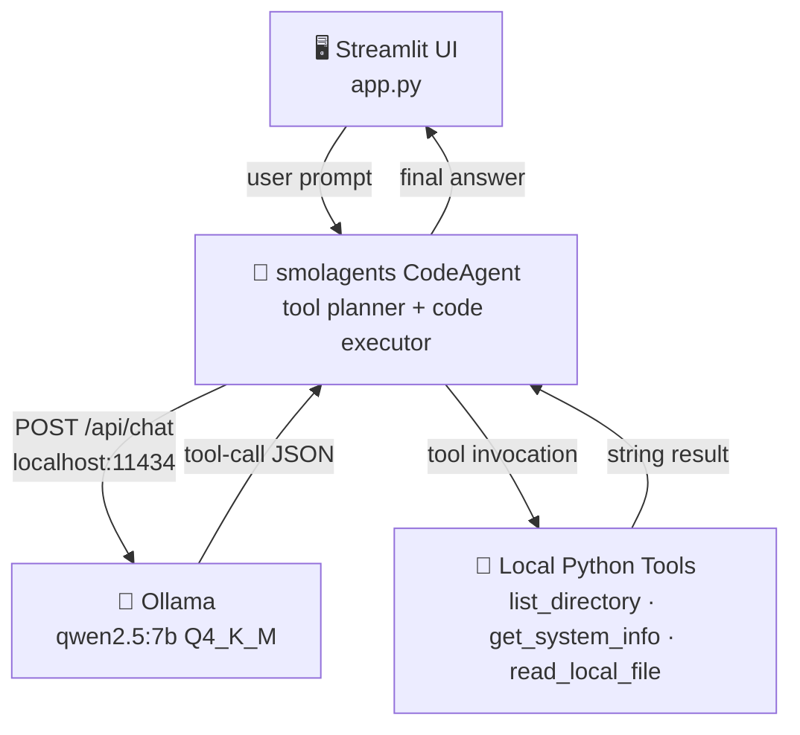

<div align="center">

# ✦ AURA
### Offline Autonomous Agent & Hardware Feasibility Study


**A fully offline, air-gapped autonomous agent that runs entirely on consumer hardware —  
no cloud API keys, no telemetry, no data ever leaves your machine.**

</div>

---

## 📸 Preview

> *Screenshot / GIF of the AURA dark UI and animated penguin mascot thinking loop goes here.*  
> *(Place a `docs/aura_preview.gif` or `docs/aura_screenshot.png` and uncomment the line below)*

<!--  -->

---

## 🗂️ Repository Structure

```
AURA/
├── app.py                  # Streamlit workspace (dark UI + mascot)
├── local_agent.py          # CLI-first CodeAgent entry point
├── requirements.txt        # Pinned Python dependencies
├── .gitignore
├── docs/
│   └── project_aura_summary.pdf   # Full feasibility report
└── README.md
```

---

## 🏗️ Architecture

```
┌─────────────────────────────────────────────────────────────┐
│                        User Interface                        │
│              Streamlit Dark UI  (app.py)                     │
│         [Chat Input] ──► [Mascot Thinking Card]              │
└────────────────────────┬────────────────────────────────────┘
                         │  prompt string
                         ▼
┌─────────────────────────────────────────────────────────────┐
│                    smolagents CodeAgent                       │
│   • Interprets intent                                        │
│   • Plans multi-step tool-call sequences                     │
│   • Writes & executes Python code in a sandbox               │
└────────────────────────┬────────────────────────────────────┘
                         │  OpenAI-compatible REST call
                         │  POST http://localhost:11434
                         ▼
┌─────────────────────────────────────────────────────────────┐
│                  Ollama  (qwen2.5:7b Q4_K_M)                 │
│   • Runs 100 % on CPU / local GPU                            │
│   • Quantized to ~4.7 GB VRAM / RAM                          │
│   • Generates reasoning + tool-call JSON                     │
└────────────────────────┬────────────────────────────────────┘
                         │  tool results (str)
                         ▼
┌─────────────────────────────────────────────────────────────┐
│                  Local Python Tools                           │
│   list_directory()  ──  OS file-system inspection            │
│   get_system_info() ──  platform / CPU / node details        │
│   read_local_file() ──  safe 2 KB file reader                │
└─────────────────────────────────────────────────────────────┘
```

**Mermaid version** (renders on GitHub):



---

## ⚡ Quick Start

### Prerequisites

| Requirement | Version | Notes |
|---|---|---|
| Python | 3.10 + | Tested on 3.14 |
| [Ollama](https://ollama.com/) | Latest | Must be running |
| RAM | ≥ 8 GB | 16 GB recommended for qwen2.5:7b |

### 1 — Clone & Install

```bash
git clone https://github.com/<your-username>/AURA.git
cd AURA

python -m venv .venv
# Windows
.venv\Scripts\activate
# macOS / Linux
source .venv/bin/activate

pip install -r requirements.txt
```

### 2 — Pull the Model

```bash
ollama pull qwen2.5:7b
```

### 3a — Launch the Streamlit UI

```bash
streamlit run app.py
```
Opens at `http://localhost:8501`.

### 3b — Use the CLI Agent

```bash
python local_agent.py
```
Drops you into an interactive REPL:
```
==================================================
Offline Local AI Agent Ready (Type 'exit' to quit)
==================================================

Agent > list the files in this directory
```

---

## 🔬 Key Findings — Hardware & Architecture Observations

### 1. Quantization vs. Coherence Trade-off

`qwen2.5:7b` in **Q4_K_M** format sits at ~4.7 GB on disk and comfortably within 8 GB RAM.  
At this quantization level, instruction-following and JSON-structured tool-call generation remain reliable for single-hop tasks. Degradation was mostly observed in multi-step chains > 5 hops, where the model occasionally lost track of previous tool observations in its context window.

### 2. RAM Bandwidth Is the Real Bottleneck

On a CPU-only setup, inference speed is **not** limited by compute (FLOPS) but by **DDR4/DDR5 memory bandwidth**. Each token generation requires streaming the full 4.7 GB of model weights through the memory bus once per forward pass. This caps throughput at roughly:

```
tokens/sec  ≈  memory_bandwidth_GB_s  /  model_size_GB
           ≈  48 GB/s  /  4.7 GB  ≈  ~10 tok/s  (DDR4 dual-channel)
           ≈  90 GB/s  /  4.7 GB  ≈  ~19 tok/s  (DDR5 dual-channel)
```

Observed: **8–12 tokens/sec** on a DDR4 system — consistent with the theoretical estimate.

### 3. Tool-Calling Overhead

Each round-trip through a tool call adds a **full generation pass** for the JSON output plus a second pass to integrate the observation. On the local CPU setup, a simple two-tool chain added ~6–10 seconds of latency vs. a zero-tool answer. Keeping tools fast (pure Python, no I/O blocking) was critical to keeping the loop responsive.

### 4. Air-Gap Feasibility Verdict

| Scenario | Verdict |
|---|---|
| Single-user personal assistant (< 5 tasks/min) | ✅ Fully viable |
| Small team (2–4 concurrent users) | ⚠️ Needs GPU (RTX 3080+) or Apple Silicon |
| High-throughput production workload | ❌ Cloud / dedicated inference server required |

---

## 🛠️ Tech Stack

| Layer | Component |
|---|---|
| **Frontend** | [Streamlit](https://streamlit.io/) — dark UI with animated SVG mascot |
| **Agent Framework** | [smolagents](https://github.com/huggingface/smolagents) — HuggingFace CodeAgent |
| **LLM Backend** | [Ollama](https://ollama.com/) — local model server |
| **Model** | `qwen2.5:7b` (Alibaba, Q4_K_M quantized) |
| **LLM Adapter** | [LiteLLM](https://github.com/BerriAI/litellm) — unified OpenAI-compatible API |
| **Python Tools** | `os`, `platform`, `subprocess` — zero external dependencies |

---

## 📄 Documentation

The full feasibility report — covering hardware benchmarks, quantization comparisons, and architectural trade-off analysis — is available in [`docs/project_aura_summary.pdf`](docs/project_aura_summary.pdf).

---

## 🔮 Potential Extensions

- [ ] Add a `web_search` tool backed by a local SearXNG instance
- [ ] Integrate `llama-index` for local RAG over a PDF folder
- [ ] Add GPU acceleration via Ollama's CUDA/ROCm backend
- [ ] Package as a Docker Compose stack (Ollama + Streamlit)
- [ ] Persistent conversation storage with SQLite

---

## 📝 License

MIT — see [LICENSE](LICENSE) for details.

---

<div align="center">
  <sub>Built as a local AI hardware feasibility study · Zero cloud dependencies · Your data stays yours.</sub>
</div>
